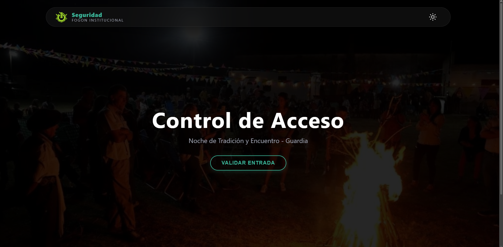
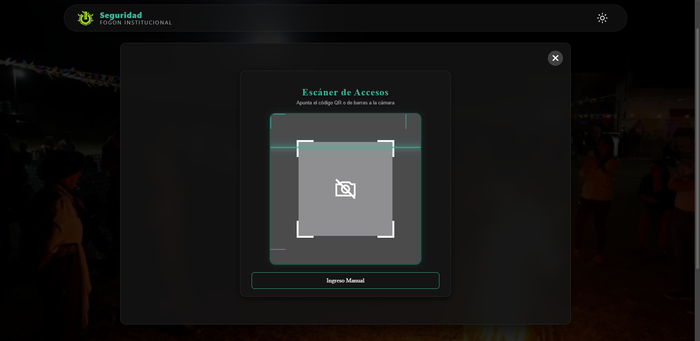
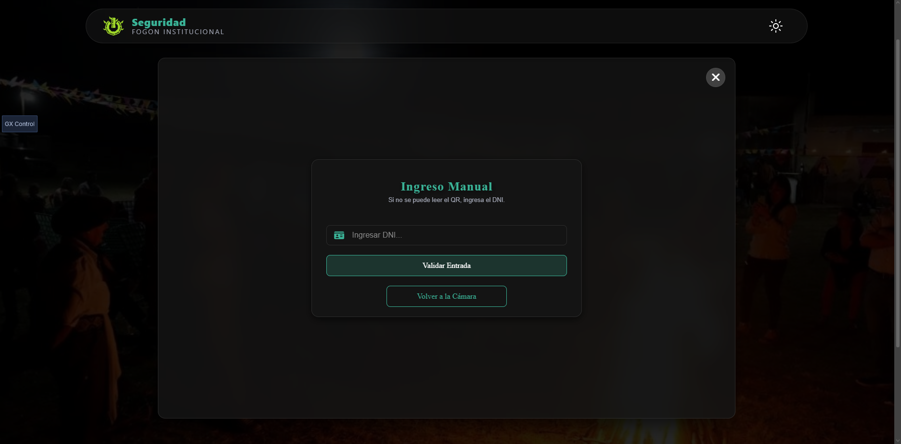
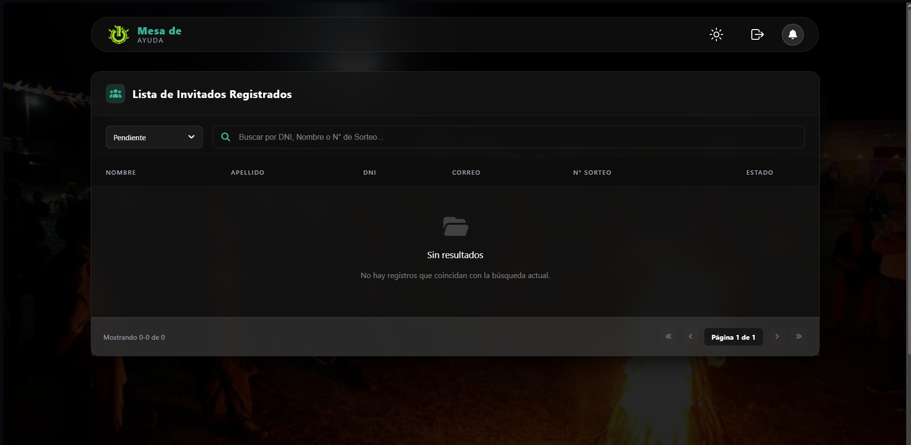
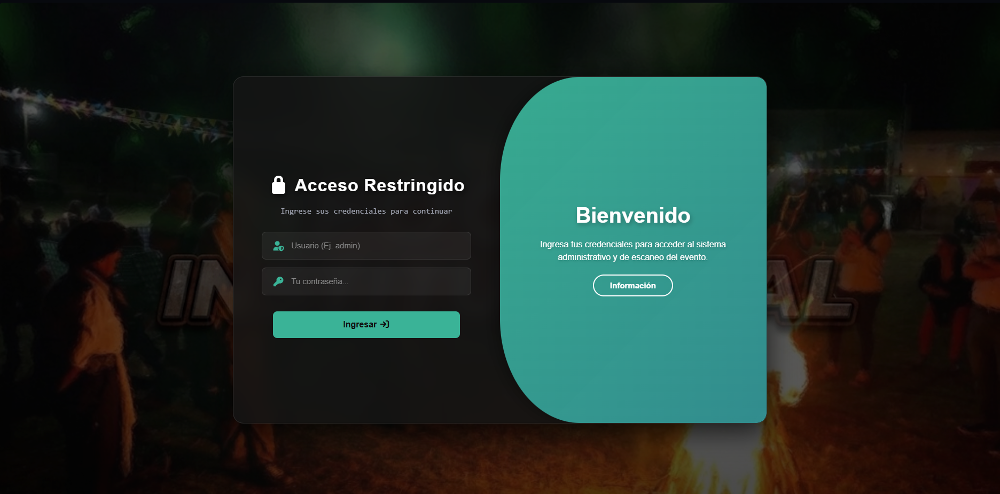
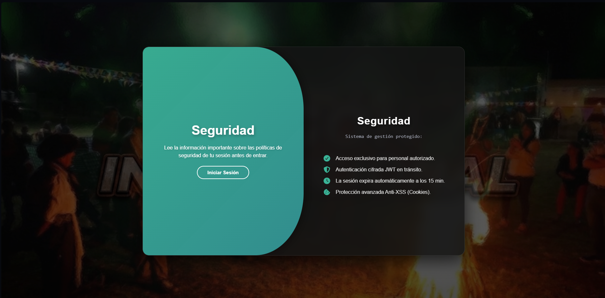
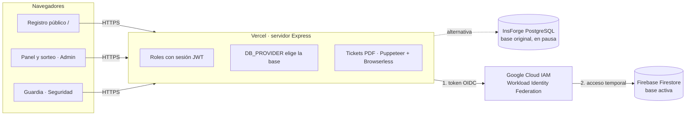

# 🔥 Fogón Institucional 2026

### Sistema de registro y control de accesos · usado en un evento real

[](https://sytemfogon.digital)


[](https://github.com/angeltarcayadev/fogon-system-showcase/blob/main/LICENSE)

Plataforma web que digitalizó las entradas del **Fogón Institucional del Día del Profesor**, organizado por el **Colegio Secundario N.º 47 «Dr. René Favaloro»** de Libertador General San Martín (Jujuy). Emite entradas en PDF con código QR, valida cada ingreso en la puerta por QR o por DNI, da a la mesa de ayuda una vista en tiempo real de los asistentes y resuelve el sorteo en vivo entre los presentes.

Fue desarrollada como proyecto de **Prácticas Profesionalizantes** de la Tecnicatura Superior en Ciencias de Datos e Inteligencia Artificial del **IES N.º 10**, y se usó en el evento del **11 de septiembre de 2026**.

> 🎟️ **679 entradas** con QR emitidas y **601 ingresos** validados en puerta en una sola noche.

> 🔒 Por el acuerdo de confidencialidad con el colegio, este repositorio es una muestra: no tiene datos personales ni el código completo.

## Miralo

[](https://sytemfogon.digital)
[](documents/qr_security_architecture.md)
[](https://angeltarcaya.vercel.app/proyectos/fogon-2026/)

## 📊 Resultados

| Indicador | Resultado |
| --- | --- |
| Docentes registrados | **679**, de **25** instituciones de la zona |
| Entradas emitidas (PDF con QR) | **679**, una por docente |
| Ingresos validados en puerta | **601** (88,5 %) |
| Instituciones con asistencia mayor al 75 % | **23 de 25** |
| Sorteo en vivo | Realizado desde la plataforma, solo entre presentes |
| Respaldo de datos | **679 de 679** registros migrados y verificados |

> Todos los números son totales del sistema. Por el acuerdo de confidencialidad con la dirección del colegio, este repositorio **no contiene datos personales** de los asistentes ni el código fuente completo.

---

## 🧩 El problema

El colegio tenía cientos de entradas vendidas desde principios de año, registradas en planillas de papel, y necesitaba:

- Controlar el ingreso de **cientos de docentes en una sola noche**, sin filas eternas.
- **Verificar la identidad** de cada asistente: entradas personales e intransferibles, con DNI.
- Que **una misma entrada no pudiera usarse dos veces**.
- Resolver consultas en el momento: docentes sin el QR, entradas observadas.
- **Proteger los datos personales** de los docentes.

## ✅ La solución

### Módulos

| Módulo | Ruta | Rol | Qué hace |
| --- | --- | --- | --- |
| Registro público | `/` | Público | Registro del docente y su institución; genera la entrada |
| Ticket | — | Público | Entrada en PDF con QR única (UUID), lista para mostrar o imprimir |
| Guardia | `/guardia` | Seguridad | Escanea el QR o valida por DNI, con respuesta por colores |
| Mesa de ayuda | `/panel` | Admin | Busca por DNI, nombre o institución; filtra por estado y corrige manualmente |
| Sorteo | `/sorteo` | Admin | Sorteo en vivo solo entre presentes, sin repetir ganadores |

### Validación en puerta por colores

- 🟢 **Verde:** entrada válida, el docente ingresa.
- 🟡 **Amarillo:** entrada ya usada; se deriva a la mesa de ayuda.
- 🔴 **Rojo:** código inválido o entrada denegada.

### Capturas

| Control de acceso (guardia) | Escáner QR |
| :---: | :---: |
|  |  |
| **Ingreso manual por DNI** | **Mesa de ayuda** |
|  |  |
| **Acceso restringido por rol** | **Políticas de sesión** |
|  |  |

---

## 🏗️ Arquitectura



- **Backend serverless** con Express sobre Vercel.
- **Base de datos principal:** PostgreSQL (InsForge), con almacenamiento de los tickets PDF.
- **Base de respaldo:** Firebase Firestore. La variable `DB_PROVIDER` permite cambiar de base **sin tocar el código**.
- **Conexión sin claves** entre Vercel y Google Cloud mediante *Workload Identity Federation*: no hay credenciales guardadas en el servidor.
- **Tickets PDF** generados con Puppeteer y Browserless.
- **Escáner** en el navegador del celular con HTML5-QRCode.

## 🔐 Seguridad

- **Roles separados:** Admin entra por `/login-panel` al panel y al sorteo, y Seguridad entra por `/login` a la guardia, cada uno con sus credenciales.
- **Sesiones JWT en cookies HttpOnly**, con vencimiento automático.
- **Validación transaccional:** una entrada no puede ingresar dos veces, aunque se escanee en dos puertas al mismo tiempo.
- **QR de doble flujo:** si alguien escanea la entrada con la cámara común del celular, llega a una página de acceso restringido; solo el escáner de la guardia extrae el identificador y lo valida. 📖 [Ver el caso de estudio](./documents/qr_security_architecture.md)
- **Confidencialidad:** los datos se usaron solo dentro de la plataforma, como se acordó con la dirección del colegio.

---

## 📂 Contenido de este repositorio

Este es un **repositorio de muestra**: el código completo es privado por la confidencialidad de los datos.

```
├── assets/            → capturas de la plataforma
├── code_snippets/     → fragmentos de la validación QR y la generación de entradas
└── documents/         → caso de estudio de la arquitectura de seguridad QR
```

---

## 👥 Créditos

<h3 align="center">Desarrollo de la plataforma</h3>

<p align="center">
  <a href="https://github.com/angeltarcayadev">
    
  </a>
  <br>
  <strong>Angel Tarcaya</strong>
  <br>
  <sub>Desarrollo full stack · arquitectura · despliegue</sub>
</p>

<h3 align="center">Coordinación</h3>

<table align="center">
  <tr>
    <td align="center" width="200">
      
      <br>
      <strong>Damián Tejerina</strong>
      <br>
      <sub>Coordinación y nexo con la dirección del colegio</sub>
    </td>
    <td align="center" width="200">
      
      <br>
      <strong>Angel Tarcaya</strong>
      <br>
      <sub>Coordinación del equipo y del proyecto</sub>
    </td>
  </tr>
</table>

<h3 align="center">Colaboradores · equipo Arce Tech</h3>

<p align="center">
  Estudiantes de la Tecnicatura Superior en Ciencias de Datos e IA del IES N.º 10 que operaron el sistema durante el evento.
</p>

<table align="center">
  <tr>
    <td align="center" width="170">
      
      <br>
      <strong>Nicolás Arce</strong>
      <br>
      <sub>Seguridad (guardia) y carga de datos</sub>
    </td>
    <td align="center" width="170">
      
      <br>
      <strong>Luciano Vaca</strong>
      <br>
      <sub>Seguridad (guardia) y carga de datos</sub>
    </td>
    <td align="center" width="170">
      
      <br>
      <strong>Maxi Tamayo</strong>
      <br>
      <sub>Seguridad (guardia) y carga de datos</sub>
    </td>
  </tr>
</table>

<table align="center">
  <tr>
    <td align="center" width="170">
      
      <br>
      <strong>Facundo Saldaño</strong>
      <br>
      <sub>Seguridad (guardia) y carga de datos</sub>
    </td>
    <td align="center" width="170">
      
      <br>
      <strong>Enzo Tamayo</strong>
      <br>
      <sub>Mesa de ayuda (panel Admin) y carga de datos</sub>
    </td>
  </tr>
</table>

### Instituciones

- **Institución destinataria:** Colegio Secundario N.º 47 «Dr. René Favaloro».
- **Institución formadora:** IES N.º 10, sede Fraile Pintado, en el marco de las Prácticas Profesionalizantes.

## Autor

**Angel Eduardo Tarcaya** · Desarrollador web · Datos e IA · Jujuy, Argentina

[](https://angeltarcaya.vercel.app/proyectos/fogon-2026/)
[](https://github.com/angeltarcayadev)
[](mailto:angeltarcaya.dev@gmail.com)

- **Institución destinataria:** Colegio Secundario N.º 47 «Dr. René Favaloro».
- **Institución formadora:** IES N.º 10, sede Fraile Pintado, en el marco de las Prácticas Profesionalizantes.

✉️ **Contacto:** angeltarcaya.dev@gmail.com
